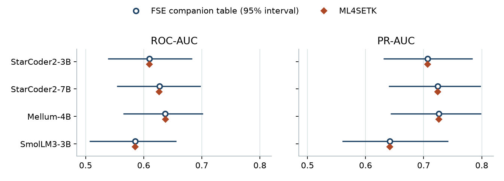

# AST-PAC reproduction report

## Koohestani et al., Figure 2 · Scoring the published AST neighbors

On the StarCoder2-3B pilot, the FSE companion table gives **0.610 ROC-AUC and 0.707 PR-AUC**. ML4SETK measured **0.609604 and 0.706842**. The same comparison below covers all four models on 132 exact members and 93 nonmembers in the Mid-Low alphanumeric stratum. Each file was scored with the five AST variants supplied in the deposit. [Koohestani et al., FSE Companion 2026](https://doi.org/10.1145/3803437.3805588) · [RQ3 exact-member companion table](https://doi.org/10.5281/zenodo.18348152)



| Model | Reference ROC-AUC | ML4SETK ROC-AUC | Reference PR-AUC | ML4SETK PR-AUC |
| --- | ---: | ---: | ---: | ---: |
| StarCoder2-3B | 0.610 | 0.609604 | 0.707 | 0.706842 |
| StarCoder2-7B | 0.627 | 0.626792 | 0.724 | 0.723929 |
| Mellum-4B | 0.637 | 0.637260 | 0.726 | 0.726284 |
| SmolLM3-3B | 0.585 | 0.585044 | 0.642 | 0.641550 |

The horizontal lines show the authors’ 95% bootstrap intervals. Diamonds show the reproduced point estimates. The four-model fixed-neighbor run also scored all 12,422 files per model, but its full-run logs retained only summary counts. The pilot supplies the paired numerical values shown here. This experiment checks scoring and calibration using existing syntax edits. [Pilot values and published interval bounds (CSV)](data/ast_pac_fixed_pilot.csv)

## RQ3 · Fresh AST neighbors on the full Java benchmark

An earlier run generated five new neighbors per file with the authors’ Java augmentation function and scored them with ML4SETK. For the **complex-file stratum, exact members versus nonmembers**, the paper’s companion table and this run give the following values. The downloadable table includes the remaining strata and bootstrap endpoints. [FSE artifact, RQ3](https://doi.org/10.5281/zenodo.18348152)

| Model | Reference ROC-AUC | ML4SETK ROC-AUC | Reference PR-AUC | ML4SETK PR-AUC |
| --- | ---: | ---: | ---: | ---: |
| StarCoder2-3B | 0.638 | 0.637354 | 0.603 | 0.601034 |
| StarCoder2-7B | 0.654 | 0.653155 | 0.622 | 0.619708 |
| Mellum-4B | 0.680 | 0.683106 | 0.657 | 0.662257 |
| SmolLM3-3B | 0.567 | 0.563401 | 0.513 | 0.512381 |

[Full FSE comparison table (CSV)](data/ast_pac_fse.csv) · [Four-model protocol and plots](full_benchmark.md)

### Earlier StarCoder2-3B control

The earlier 225-file run used a different model forward call. The last column recomputes areas from the authors’ saved scores. [Forward-pass control and earlier command](full_benchmark.md#forward-pass-control)

| Metric | FSE companion table | Run with fresh model scores | Evaluator on archived scores |
| --- | ---: | ---: | ---: |
| ROC-AUC | 0.610 | 0.609278267 | 0.609604106 |
| PR-AUC | 0.707 | 0.706530510 | 0.706830917 |

## Reproduce these measurements

[Reproduction script](https://github.com/jkatzy/ML4SE-toolkit/blob/1293774/reproductions/test_ast_pac.py) · [Environment and inputs](index.md)

```bash
/tmp/ml4setk-repro/bin/python -m pytest -o addopts= -qs reproductions/test_ast_pac.py
```
