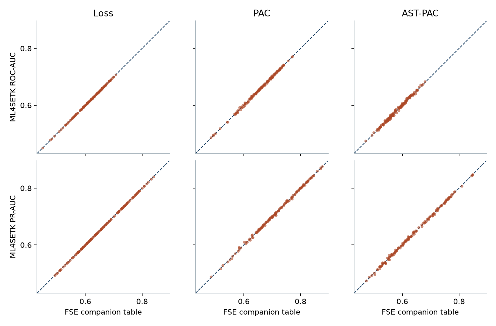

# FSE benchmark protocol and earlier four-model results

This experiment tests whether a benchmark implementation of `MembershipScorer` can score Java source through `score_many`, whether the shared and method-specific evaluators agree, and how accurately fresh measurements recover the FSE results. The reference study is Roham Koohestani, Ali Al-Kaswan, Jonathan Katzy, and Maliheh Izadi, *AST-PAC: AST-guided Membership Inference for Code*, FSE Companion 2026. [Proceedings paper](https://doi.org/10.1145/3803437.3805588) · [Versioned replication package](https://doi.org/10.5281/zenodo.18348152)

This benchmark supplements the AST-PAC paper report. This page preserves the earlier joint benchmark, which used the FSE authors’ external Java augmentation function for AST-PAC. [AST-PAC report and reproduction script](ast_pac.md)

## Four-model results

The November 21–22, 2026 run produced **149,064 fresh scores** across 49,688 model–file pairs on two NVIDIA A40 GPUs. Each model scored 12,422 files with all three methods. The joint evaluator and each method evaluator agreed exactly on every area they both computed. Their ROC-AUC and trapezoidal PR-AUC agreed with scikit-learn to an absolute tolerance of `1e-12`.



Each panel shows 144 paired estimates across four models, three membership comparisons and 12 eligible strata. The diagonal marks equal AUCs. The Loss and PAC references are from the RQ2 companion tables, and AST-PAC is from RQ3. For this full-benchmark run, PAC used newly drawn token swaps and AST-PAC used the authors’ Java neighbor generator.

The tables below are downloadable aggregates from the same run. Each row identifies the source (printed paper, companion table or notebook), model, positive cohort, stratum and metric, followed by the reference and ML4SETK values. ROC and PR lower/upper rows give bootstrap interval endpoints. For Figure 3, the entries are quantiles of the change ratio. The reference aggregates are from Koohestani et al.’s paper and Roham Koohestani’s versioned deposit (CC BY 4.0). The paired tables and figures combine these values with the toolkit measurements. [Replication package](https://doi.org/10.5281/zenodo.18348152) · [License](https://creativecommons.org/licenses/by/4.0/)

| Method | Paired aggregate values | Comparison in the FSE report |
| --- | --- | --- |
| Loss | [Download CSV](data/loss_fse.csv) | [Loss baseline](ast_pac.md#loss-baseline) |
| PAC | [Download CSV](data/pac_fse.csv) | [PAC baseline](ast_pac.md#pac-baseline) |
| AST-PAC | [Download CSV](data/ast_pac_fse.csv) | [AST-PAC](ast_pac.md) |

## Protocol

For each of the four models, the notebooks' complete-case filter selects 12,422 of the 12,423 recorded observations. The runner joins their identifiers to `dataset/full.parquet` using ID, repository, path, and membership type. Each model sees 4,193 exact members, 4,014 near-members, and 4,215 nonmembers. The artifact supplies cohort selection and reference values. The new scoring path receives the original source and locally generated neighbors.

The experiment adapter implements `score(model, source)`. The inherited `score_many` dispatches each source in order. Loss returns mean next-token log probability. PAC and AST-PAC return the mean neighbor polarized gap minus the original gap, giving the joint API its higher-is-member convention. The method-specific evaluators for archived PAC data take the opposite sign. Each model runs in evaluation mode, with float16 weights, scaled dot-product attention, and the artifact's 8,192-token cap. The original source and all five neighbors per perturbation method are tokenized independently.

For each file the experiment derives a seed from the first eight bytes of the SHA-256 digest of its UTF-8 contents, interpreted as an unsigned big-endian integer. PAC uses the model tokenizer and the artifact's token-swap sampling rule. AST-PAC calls the study authors’ Java augmentation function from the replication package with that seed. The authors' draw sequence was unavailable. A difference in the final paper cells can arise even when two implementations of the metrics agree on identical inputs.

| Model | Pinned checkpoint and tokenizer |
| --- | --- |
| StarCoder2-3B | [733247c](https://huggingface.co/bigcode/starcoder2-3b/tree/733247c55e3f73af49ce8e9c7949bf14af205928) |
| StarCoder2-7B | [bb9afde](https://huggingface.co/bigcode/starcoder2-7b/tree/bb9afde76d7945da5745592525db122d4d729eb1) |
| Mellum-4B | [83cce26](https://huggingface.co/JetBrains/Mellum-4b-base/tree/83cce2605fbdf6a3868627e9b0a5924e0072b94d) |
| SmolLM3-3B | [a07cc9a](https://huggingface.co/HuggingFaceTB/SmolLM3-3B/tree/a07cc9a04f16550a088caea529712d1d335b0ac1) |

## Forward-pass control

The initial experiment suppressed the model cache and supplied token IDs alone. On complete-case rows 0 and 64 of each model, supplying the tokenizer's attention mask removed the observed differences in original-file loss and polarized gap relative to the authors' forward call. The full run uses the complete tokenizer inputs, labels equal to the input IDs, and the model's default cache behavior. The preliminary scores were kept in a separate run.

With identical seeded neighbors on those two files per model, the corrected adapter matched all 24 independently recomputed scores from the deposited implementation within absolute tolerance `1e-12`. The largest absolute difference was `1.8e-15`. To repeat this control, add `--check-reference-only` to each model command below.

## Comparisons

- **API agreement.** For each eligible aggregate and stratified comparison, the analysis checks both API outputs against scikit-learn's ROC-AUC and trapezoidal PR-AUC, with absolute tolerance `1e-12`. For the RQ1 threshold metrics, it selects Youden's cutoff as in the notebook and checks `MembershipThreshold.predict_many` against the inclusive array comparison.
- **Per-file agreement.** After scoring finishes, join the 12,422 fresh observations per model to the archived scores by file identity. Compare median and maximum absolute differences and Spearman rank correlation after aligning score direction.
- **Table 1 and RQ1.** Compare the 48 aggregate area estimates for PAC and Loss to the final PDF at three decimals. Compare areas, accuracy, precision, recall, and F1 to the saved RQ1 notebook at six decimals.
- **Table 2.** Check the ten dataset cutoffs using the complete 12,484-row input dataset.
- **RQ2 and RQ3.** Check the full set of eligible strata across three membership scenarios and three grouping dimensions. Compare all 1,152 area estimates in the six deposited tables at three decimals. PAC appears in both comparisons. Compute 95% percentile intervals with 1,000 row-wise bootstrap resamples, using seed 42. The authors' unseeded intervals are stochastic.
- **Figure 3.** Recompute the 72 median and quartile values for the PAC and AST-PAC character change ratios from newly generated neighbors. Compare to the saved RQ3 notebook at six decimals.

As an analysis control, feeding the authors' saved scores and ratios into the same evaluator reproduced all 1,152 stratified point estimates, 144 RQ1 notebook metrics, and 72 Figure 3 statistics. The two discrepancies in printed Table 1 were the previously documented StarCoder2-7B PAC cells. [Archived-score comparison](archived_scores.md)

## Repeat the historical run with the authors’ AST generator

Use Python 3.13, a CUDA-capable GPU, and Poppler's `pdftotext`. From the repository root, extract the **entire** Zenodo archive after checking its MD5 (`2f137cfa98c98f1088d9454485840283`). Download the final proceedings PDF. The external Java augmentation dependency is `attacks/pac_ast_attack.py` in the pinned CC BY 4.0 deposit. ML4SETK imports it from the extracted artifact. The dependency, Java corpus, checkpoints, and per-file results remain external to the distribution. [Artifact and license](https://doi.org/10.5281/zenodo.18348152) · [Proceedings PDF](https://repository.tudelft.nl/file/File_af66d741-b167-4406-9bc1-7f4474f47fed)

```bash
uv venv --python 3.13 /tmp/fse-api-env
uv pip install --python /tmp/fse-api-env/bin/python -e . \
    torch==2.8.0 transformers==4.55.4 numpy==2.5.5 pandas==3.0.6 \
    pyarrow==25.0.0 scikit-learn==1.9.1 tree-sitter==0.25.2 \
    tree-sitter-java==0.23.5 Levenshtein==0.27.3 lxml==6.1.3
artifact=/tmp/ast-pac-fse-ivr-submission
output=tmp/mia_full_api
for model in SC2-3B SC2-7B mellum smollm; do
    /tmp/fse-api-env/bin/python scripts/run_fse_api_benchmark.py "$artifact" "$output" "$model" || exit 1
done
/tmp/fse-api-env/bin/python scripts/evaluate_fse_api_benchmark.py "$artifact" /tmp/paper.pdf "$output"
```

Each model saves completed batches in a separate SQLite file in the output directory. Repeating a command there resumes that run. An empty output directory starts a new experiment. The analysis requires complete per-model cohort coverage and writes the paper comparisons and per-file agreement summaries as aggregate CSVs per model.

## Repeat the earlier fixed-input pilot

For the earlier 225-file comparison with fixed neighbors, use a CUDA-capable
GPU from the repository root. The experiment used two A40s
with files distributed across devices. One GPU can process the entire stratum
sequentially using the default `--gpus 1`. Download and verify the versioned
artifact, then run the three methods together to share the original-file
forward passes. The runner downloads the pinned model and tokenizer on first
use. For an offline run, pass `--checkpoint /path/to/pinned/snapshot`.

```bash
curl -fL https://zenodo.org/api/records/18348152/files/ast-pac-fse-ivr-submission.zip/content -o /tmp/fse-mia.zip
echo '2f137cfa98c98f1088d9454485840283  /tmp/fse-mia.zip' | md5sum -c -
unzip -o /tmp/fse-mia.zip 'ast-pac-fse-ivr-submission/dataset/full.parquet' \
    'ast-pac-fse-ivr-submission/results/results_sc2_3b_new_approach_orig_m_worker_0.parquet' -d /tmp
uv run --python 3.13 --with torch==2.8.0 --with transformers==4.55.4 \
    --with numpy==2.5.5 --with pandas==3.0.6 --with pyarrow==25.0.0 \
    python scripts/reproduce_mia_stratum.py /tmp/ast-pac-fse-ivr-submission --gpus 2
```

The runner in `scripts/reproduce_mia_stratum.py` uses original
ML4SETK experiment code and the package's three public evaluators. It joins
the deposited complete cases to Java source by ID, repository, path, and
membership label. PAC and AST-PAC use the five archived neighbor texts for
each method and file. Reusing those texts holds random perturbations fixed
while testing tokenization, model inference, scoring, and evaluation.
The external inputs and model weights are downloaded separately.
[Versioned dataset and reference results](https://doi.org/10.5281/zenodo.18348152) · [Model revision](https://huggingface.co/bigcode/starcoder2-3b/tree/733247c55e3f73af49ce8e9c7949bf14af205928)
