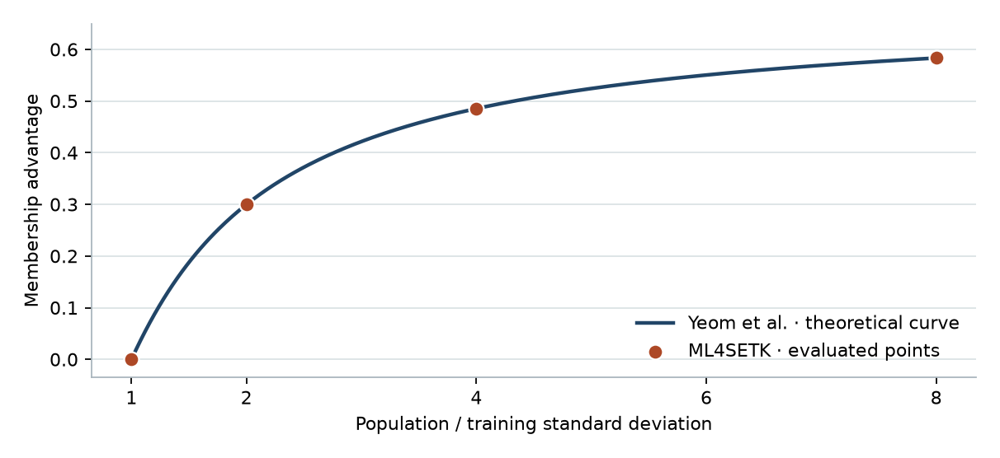

# Loss reproduction report

*Privacy Risk in Machine Learning: Analyzing the Connection to Overfitting*. Samuel Yeom, Irene Giacomelli, Matt Fredrikson, and Somesh Jha. IEEE CSF 2018. [Paper](https://doi.org/10.1109/CSF.2018.00027)

## Yeom et al., Figure 2b · Membership advantage

Figure 2b predicts how membership advantage changes as the ratio of population to training error standard deviations increases. Advantage is the fraction of training examples classified as members minus the corresponding fraction of population examples. The paper column evaluates the authors’ Gaussian formula. The ML4SETK column applies `MembershipThreshold` to 10,000 deterministic Gaussian quantiles per cohort. At a ratio of 8, the paper predicts 0.583213 and the toolkit measures 0.5832. [Figure 2b and its derivation](https://www.cs.cmu.edu/~mfredrik/papers/YeomCSF18.pdf)

The four measured points check the theoretical curve. The trained regression and tree models plotted in the same panel remain untested here.



| Population / training standard deviation | Paper advantage (theory) | ML4SETK advantage |
| ---: | ---: | ---: |
| 1 | 0.000000 | 0.0000 |
| 2 | 0.299765 | 0.2996 |
| 4 | 0.485277 | 0.4852 |
| 8 | 0.583213 | 0.5832 |

[Figure 2b comparison data (CSV)](data/loss_figure2b.csv)

## Coverage of the original paper

**Partial.** The CPU script checks four points on one theoretical curve. All empirical panels remain pending. No hardware exception is documented. [CSF paper and captions](https://www.cs.cmu.edu/~mfredrik/papers/YeomCSF18.pdf)

| Published item | Published comparison | Toolkit evidence |
| --- | --- | --- |
| Figure 1 | Theoretical attribute advantage versus influence at three population/training error ratios | Pending |
| Figure 2a | Theory and trained ridge/tree models on Eyedata, IWPC, and Netflix, with both error scales known | Pending |
| Figure 2b | Same three datasets, with only the training error scale known | Four theoretical points measured above. All three empirical series, averaged over 100 random splits, are pending. |
| Figure 2c | Theory and CNN measurements across network sizes on MNIST, CIFAR-10, and CIFAR-100 | Pending |
| Figure 3a–b | Four membership and attribute inference comparisons for each of two IWPC genetic attributes, VKORC1 and CYP2C9 | Both panels pending |
| Figure 4a–b | Membership advantage and train–test accuracy gap across eight CNN sizes on three image datasets | Both panels pending |
| Table I | Precision and recall for the image datasets, alongside the Shokri et al. baseline | Pending |

## Reproduce these measurements

Run from the repository root on CPU. [Reproduction script](https://github.com/jkatzy/ML4SE-toolkit/blob/2e976ea/reproductions/test_loss.py)

```bash
uv venv --python 3.13 /tmp/ml4setk-repro
uv pip install --python /tmp/ml4setk-repro/bin/python -e . pytest==9.0.2
/tmp/ml4setk-repro/bin/python -m pytest -o addopts= -qs reproductions/test_loss.py
```
