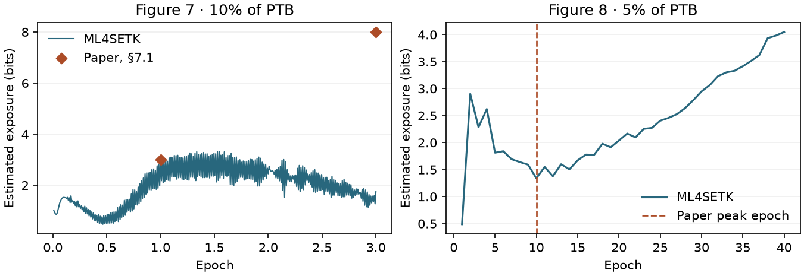

# The Secret Sharer

Nicholas Carlini, Chang Liu, Úlfar Erlingsson, Jernej Kos, and Dawn Song. *The Secret Sharer: Evaluating and Testing Unintended Memorization in Neural Networks*. USENIX Security 2019. [Proceedings](https://www.usenix.org/conference/usenixsecurity19/presentation/carlini) · [Toolkit module](https://github.com/jkatzy/ML4SE-toolkit/blob/5373db3/src/ml4setk/Extraction/exposure.py) · [Reproduction script](https://github.com/jkatzy/ML4SE-toolkit/blob/5373db3/reproductions/ml4setk/Extraction/test_exposure.py)

## Published and measured exposure

We trained two character-level LSTMs from scratch, planting one known nine-digit canary in each training corpus. On 10% of Penn Treebank (PTB), the first epoch ended near the paper’s estimate. By epoch three, the paper reported substantially stronger memorization. On the 5% corpus, the lowest held-out loss and highest epoch-end exposure both came at the last measured epoch. [Paper, §§7.1–7.2 and Figures 7–8](https://www.usenix.org/system/files/sec19-carlini.pdf)

| Comparison | Paper | ML4SETK | Evidence |
| --- | ---: | ---: | --- |
| Table 1, rank of the planted canary | 1 | 1 | Recalculation using the nine published losses |
| Figure 7, exposure after epoch 1 | ≈3 bits | 2.900652 bits | Fresh training |
| Figure 7, exposure after epoch 3 | ≈8 bits | 1.765781 bits | Fresh training |
| Figure 8, epoch of minimum test loss | 10 | 40 | Fresh training through epoch 40 |
| Figure 8, epoch of maximum exposure | 10 | 40 | Fresh training through epoch 40 |
| §7.2, exposure at epochs 10 and 40 | Epoch 10 higher | 1.338667 and 4.048715 bits | Opposite ordering in the fresh run |



Exposure equals log₂(space size) − log₂(rank). Smaller loss is more likely. Tied alternatives count toward the known canary’s rank. Applying the definition to the reported rank of 1 in a space of one billion possibilities gives 29.897353 bits. This arithmetic uses the paper’s rank claim for the full space. [Per-batch measurements](ptb_batches.csv) · [Epoch-end exposure and losses](ptb_epochs.csv)

## What the training run measures

Both runs used the first 10% or 5% of the pinned PTB training file by bytes, with one insertion at the beginning, no shuffling, two 200-unit LSTM layers, 128-dimensional embeddings, SGD with learning rate 1, batch size 64, 64-character unrolls, gradient clipping at 5, and seed 19. The paper specifies the corpus proportions, architecture, insertion policy and number of epochs. The exact original corpus slice, checkpoint, initialization seed, and optimizer configuration for these panels were unavailable. We chose and fixed those settings for this run. Test loss is the mean next-character cross-entropy in nats on the held-out PTB test file.

We estimated rank using the same 8,191 uniformly sampled alternative numerals at every measurement plus the planted numeral. This finite-sample estimator resolves at most 13 bits. The paper also describes a distribution-fit estimator for high-exposure tails. The Figure 7 discrepancy occurs below the sample ceiling. Only aggregate loss, rank, and exposure are stored. The corpus was obtained from the public LSTM benchmark mirror and remains an external input. [PTB mirror revision](https://github.com/wojzaremba/lstm/tree/76870253cfca069477f06b7056af87f98490b6eb/data) · [Authors’ description of the planted-canary experiment](https://bair.berkeley.edu/blog/2019/08/13/memorization/)

## Run it

After [installing the toolkit](../index.md#installation-for-the-reproduction-scripts), this example measures a known canary with one equally or more likely alternative in a space of eight.

```python
from ml4setk.Extraction import canary_rank, exposure_bits

rank = canary_rank(1.0, [0.5, 2, 3, 4, 5, 6, 7])
print(rank, exposure_bits(8, rank))  # 2 2.0
```

```bash
ptb_url=https://raw.githubusercontent.com/wojzaremba/lstm/76870253cfca069477f06b7056af87f98490b6eb/data
curl -fL "$ptb_url/ptb.train.txt" -o /tmp/ptb.train.txt
curl -fL "$ptb_url/ptb.test.txt" -o /tmp/ptb.test.txt
ML4SETK_PTB_TRAIN=/tmp/ptb.train.txt ML4SETK_PTB_TEST=/tmp/ptb.test.txt \
  CUBLAS_WORKSPACE_CONFIG=:4096:8 python -m pytest -o addopts= -qs reproductions/ml4setk/Extraction/test_exposure.py
```

## Coverage

| Published items | Coverage |
| --- | --- |
| Table 1, Figures 7–8 | Published rank checked. Two fresh PTB runs with the differences above. |
| Figures 1–6 | Production completion, illustrative overtraining, fitted exposure distribution, word-level, character-level, and translation comparisons remain open. |
| Figures 9–11, Table 2 | Search illustration, efficiency, and Enron recovery experiments outside the known-canary evaluation. |
| Table 3, Appendix Tables 4–6 | Differential privacy, architecture, batch/model size, and format sweeps remain open. |
