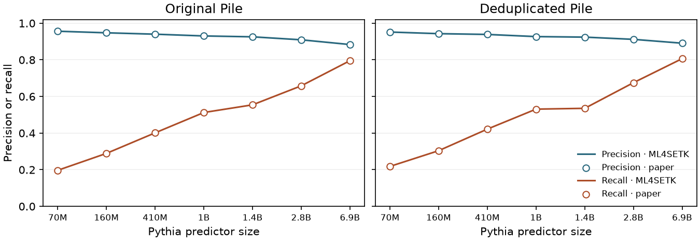

# Emergent and Predictable Memorization in Large Language Models

Stella Biderman, USVSN Sai Prashanth, Lintang Sutawika, Hailey Schoelkopf, Quentin Anthony, Shivanshu Purohit, and Edward Raff. NeurIPS 2023. [Proceedings](https://proceedings.neurips.cc/paper_files/paper/2023/hash/59404fb89d6194641c69ae99ecdf8f6d-Abstract-Conference.html) · [Toolkit module](https://github.com/jkatzy/ML4SE-toolkit/blob/5373db3/src/ml4setk/Extraction/predictable.py) · [Reproduction script](https://github.com/jkatzy/ML4SE-toolkit/blob/66ca4cf/reproductions/ml4setk/Extraction/test_predictable.py)

## Which examples does a larger model memorize?

We recomputed precision and recall from the authors’ released sets of memorized training-record IDs. Precision is the share of a smaller model’s memorized records also memorized by the final 12B model. Recall is the share of the final model’s memorized records identified by the smaller model. Following the analysis code, we restrict both sets to IDs below 23,552,000 (23,000 steps × 1,024 records). On the original Pile, the 70M model identifies about one fifth of the 12B model’s memorized records, while the 6.9B model identifies about four fifths. [Published Figures 1b and 9](https://proceedings.neurips.cc/paper_files/paper/2023/file/59404fb89d6194641c69ae99ecdf8f6d-Paper-Conference.pdf) · [Authors’ analysis code](https://github.com/EleutherAI/pythia/blob/a19eecb807ec2c79a39ebf18108816e6ffffc1d5/predictable-memorization/mem_graph.py)

| Original Pile, predictor for 12B | Paper precision | ML4SETK precision | Paper recall | ML4SETK recall |
| --- | ---: | ---: | ---: | ---: |
| 70M | 0.956 | 0.956335 | 0.197 | 0.196861 |
| 160M | 0.948 | 0.947676 | 0.289 | 0.289217 |
| 410M | 0.940 | 0.940111 | 0.401 | 0.401466 |
| 1B | 0.931 | 0.930539 | 0.512 | 0.512488 |
| 1.4B | 0.926 | 0.925754 | 0.554 | 0.554336 |
| 2.8B | 0.909 | 0.909478 | 0.658 | 0.658224 |
| 6.9B | 0.884 | 0.883648 | 0.795 | 0.795411 |



The paired CSV also includes all seven deduplicated predictors and all six intermediate 12B checkpoints on each corpus. Of these 52 values, 51 round to the paper’s values. At step 83,000 on the original corpus, recall was 0.711566 versus the printed 0.711. Using all record IDs changes the comparison substantially. For example, unrestricted 70M recall was 0.186594 versus 0.196861 in the shared cohort. [All paired values (CSV)](pythia_comparisons.csv)

For Figure 1a, we also recomputed Pearson correlations between full-stream binary memorization flags. All 28 distinct model pairs agree with the printed values at three decimals. The 70M and 12B correlation is 0.419735 (paper 0.420). For Figure 7, we divided each positive count by 146,432,000 and compared all 16 model/corpus points against the markers in the paper. The CSV’s paper fractions are approximate, read from the linear y-axis to four decimal places. [All Figure 1a correlations](pythia_correlations.csv) · [All Figure 7 rates](pythia_rates.csv)

## Table 2a from the authors’ archived figures

The release lists intermediate positive IDs for 12B. For 6.9B, we read the four confusion-matrix percentages in each of the authors’ archived SVGs and used them to recalculate Table 2a. These twelve values reproduce the printed precision and recall from rounded aggregate inputs. [Pinned figure archive](https://github.com/EleutherAI/pythia/tree/a19eecb807ec2c79a39ebf18108816e6ffffc1d5/predictable-memorization/graphs/memorization_early_checkpoint_predict_last_checkpoint)

| Checkpoint (millions of sequences) | Paper precision / recall | Recomputed precision / recall |
| ---: | ---: | ---: |
| 23 | 0.919 / 0.513 | 0.918805 / 0.513139 |
| 44 | 0.913 / 0.587 | 0.912600 / 0.586890 |
| 65 | 0.910 / 0.658 | 0.909855 / 0.657550 |
| 85 | 0.910 / 0.721 | 0.910488 / 0.720791 |
| 105 | 0.915 / 0.816 | 0.915234 / 0.816487 |
| 126 | 0.945 / 0.918 | 0.945092 / 0.917710 |

## Fresh checkpoint verification

We sampled 128 records uniformly without replacement from the 1,675,077 released Pythia-2.8B positives (NumPy seed 19). For each record, we independently verified that all 32 reference suffix tokens were greedy choices after the 32-token prefix. Both checkpoints used float16, the precision in the authors’ code. Since the sample consists entirely of archived positives, the result measures agreement on those positives. Population prevalence and specificity require other cohorts. [Pinned benchmark](https://huggingface.co/datasets/EleutherAI/pythia-memorized-evals/tree/d97edd12f08884dae3dfcef8d5cbbba5129e49e0) · [Authors’ model evaluation](https://github.com/EleutherAI/pythia/blob/a19eecb807ec2c79a39ebf18108816e6ffffc1d5/predictable-memorization/eval_memorization.py)

| Model revision | Positive reference records | All 32 tokens verified |
| --- | ---: | ---: |
| Original Pythia-2.8B (v0) | 128 | 128 |
| Retrained Pythia-2.8B, same inputs | 128 | 104 |

The toolkit defaults to the original model for this comparison. Both the model ID and revision matter. The dataset card specifies MIT, and the authors’ Pythia repository specifies Apache-2.0. Both model weights and the Pile-derived benchmark remain external. [Original checkpoint](https://huggingface.co/EleutherAI/pythia-2.8b-v0/tree/b9d8cace80b1a97f5ed380711aea31f2d1b24310) · [Retrained checkpoint](https://huggingface.co/EleutherAI/pythia-2.8b/tree/2a259cdd96a4beb1cdf467512e3904197345f6a9)

## Run it

After [installation](../index.md#installation-for-the-reproduction-scripts), the following calls evaluate the same synthetic reference with the default and a caller-supplied checkpoint.

```python
import torch
from transformers import AutoModelForCausalLM
from ml4setk.Extraction import verify_pythia_records

rows = [list(range(64))]
print(verify_pythia_records(rows))  # [False]
model = AutoModelForCausalLM.from_pretrained(
    "EleutherAI/pythia-2.8b-v0", revision="b9d8cace80b1a97f5ed380711aea31f2d1b24310",
    torch_dtype=torch.float16,
).eval().to("cuda")
print(verify_pythia_records(rows, model=model))  # [False]
```

For already-labeled sets, `memorization_overlap([1, 2], [1, 3, 4])` returns precision 0.5 and recall 1/3. To reproduce the paper comparisons, download the pinned Parquet release (about 4.7 GB) and the authors’ figure archive.

```bash
hf download EleutherAI/pythia-memorized-evals --repo-type dataset \
  --revision d97edd12f08884dae3dfcef8d5cbbba5129e49e0 --include 'data/*.parquet' \
  --local-dir /tmp/pythia-memorized-evals
curl -fL https://codeload.github.com/EleutherAI/pythia/tar.gz/a19eecb807ec2c79a39ebf18108816e6ffffc1d5 -o /tmp/pythia-memorization.tar.gz
ML4SETK_PYTHIA_EVALS=/tmp/pythia-memorized-evals/data \
  ML4SETK_PYTHIA_ARTIFACT=/tmp/pythia-memorization.tar.gz \
  python -m pytest -o addopts= -qs reproductions/ml4setk/Extraction/test_predictable.py
```

## Coverage

| Published items | Coverage |
| --- | --- |
| Table 1 | Recomputed all four illustrative agreement scores from the published token-agreement masks. |
| Figure 1a | All 28 distinct pairwise correlations recomputed from original-Pile positive IDs. |
| Figures 1b and 9, Tables 2 and 3 | All precision and recall rows checked from positive IDs or the archived 6.9B confusion matrices. |
| Figure 7 | All eight model sizes on both corpora. Across the full 143,000 × 1,024 example stream, 2,382,326 / 146,432,000 yields 1.627% for the original 12B model. The caption gives 1.62%. The deduplicated 12B model gives 1.278%. |
| Figures 2, 3, 4, 5, 6, 8 and 10 | Correlation heatmaps, compute frontiers, full score distribution and doubled-length experiments remain open. The positive-ID release omits fractional agreement scores required for the score-distribution analyses. |
| Full model rerun | Fresh inference covers the fixed 128 positive controls. The larger comparisons use the authors’ archived measurements. |
