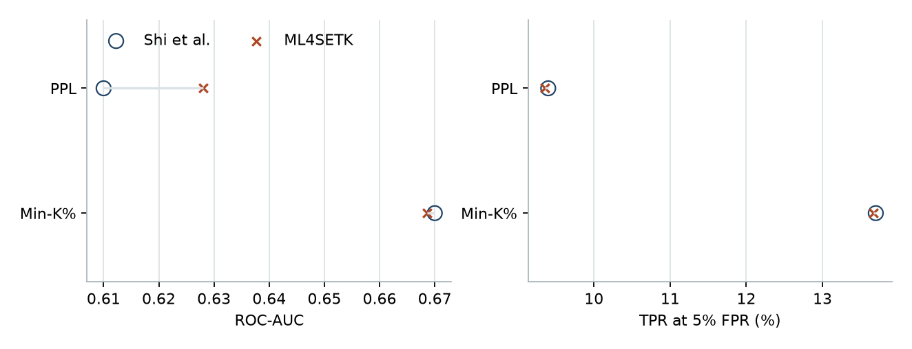

# Min-K% Prob reproduction report

Weijia Shi, Anirudh Ajith, Mengzhou Xia, Yangsibo Huang, Daogao Liu, Terra Blevins, Danqi Chen, and Luke Zettlemoyer. *Detecting Pretraining Data from Large Language Models*. ICLR 2024. [Proceedings](https://proceedings.iclr.cc/paper_files/paper/2024/hash/e32ad85fa27be4a9868d55703f01323e-Abstract-Conference.html) · [Toolkit module](https://github.com/jkatzy/ML4SE-toolkit/blob/d92635c/src/ml4setk/MIA/min_k.py) · [Reproduction script](https://github.com/jkatzy/ML4SE-toolkit/blob/d92635c/reproductions/ml4setk/MIA/test_min_k.py)

## Pythia-2.8B on original WikiMIA

Both Min-K% measurements agree with the published Pythia-2.8B original-text column at the precision printed in the paper. The perplexity control also recovers the published true-positive rate, but gives a higher ROC-AUC. The paper reports a 0.06 AUC gain over perplexity. This run measured 0.040443. [Table 1 and Appendix Table 5](https://proceedings.iclr.cc/paper_files/paper/2024/file/e32ad85fa27be4a9868d55703f01323e-Paper-Conference.pdf) · [Comparison data (CSV)](data/pythia_original.csv)

| Method | Table 1 ROC-AUC | ML4SETK ROC-AUC | Table 5 TPR at 5% FPR | ML4SETK TPR at 5% FPR |
| --- | ---: | ---: | ---: | ---: |
| Min-K% Prob, k = 20 | 0.67 | 0.668546 | 13.7% | 13.67% (19/139) |
| Perplexity | 0.61 | 0.628103 | 9.4% | 9.35% (13/139) |



**Cohort assumption.** The table captions identify the original-text setting and model, but omit the length group and model revision. We used the length-128 group, which the authors also use for their model-size analysis. The resulting counts recover both published TPRs after rounding. That agreement leaves the exact original table cohort unconfirmed. We scored every original length group separately so the effect of this choice is visible.

| WikiMIA length group | Members / nonmembers | Min-K% ROC-AUC | Perplexity ROC-AUC | Min-K% TPR | Perplexity TPR |
| ---: | ---: | ---: | ---: | ---: | ---: |
| 32 | 387 / 389 | 0.616847 | 0.613705 | 16.54% | 14.73% |
| 64 | 284 / 258 | 0.612007 | 0.584371 | 18.31% | 10.21% |
| 128 | 139 / 111 | 0.668546 | 0.628103 | 13.67% | 9.35% |
| 256 | 51 / 31 | 0.699557 | 0.678052 | 7.84% | 3.92% |

The script scores all 1,650 released texts with the pinned Pythia-2.8B model and tokenizer, one text at a time in float32 evaluation mode. It gathers each observed token’s log probability from the preceding position and omits the first token. The Min-K% score is the mean of the lowest 20%. The perplexity control ranks examples by mean log probability, which has the same ordering as increasing evidence from lower perplexity. We compute ROC-AUC from the labeled cohorts and report the highest TPR reached at FPR strictly below 0.05, following the authors’ evaluator. There is no sampling or fitted threshold in this run. [WikiMIA revision](https://huggingface.co/datasets/swj0419/WikiMIA/tree/a89ab76d88f704e9bc5870ac39cc9d458a2a70ac) · [Pythia revision](https://huggingface.co/EleutherAI/pythia-2.8b/tree/2a259cdd96a4beb1cdf467512e3904197345f6a9) · [Authors’ evaluator](https://github.com/swj0419/detect-pretrain-code/blob/a5048f93c4fa6491aab0638bb3e6fd5a662d7698/src/eval.py)

## Run the toolkit method

Install the toolkit from the repository root with `python -m pip install .`. The API takes one example’s observed-token natural log probabilities. The paper uses `k_percent=20`. Here the selected two values are −4 and −3.

```python
from ml4setk.MIA import min_k_score

log_probs = [-0.25, -4, -0.5, -2, -1, -0.75, -3, -1.5, -0.1, -0.8]
print(min_k_score(log_probs))  # -3.5
```

The toolkit rounds the token count down as in the released artifact. If the selected tail is empty, the API raises `ValueError`. Higher scores favor membership. The function accepts probabilities from any compatible model output. The linked benchmark supplies the paper checkpoint for the Pythia comparison. [Equation 1 and §4.3](https://proceedings.iclr.cc/paper_files/paper/2024/file/e32ad85fa27be4a9868d55703f01323e-Paper-Conference.pdf) · [Authors’ scoring code](https://github.com/swj0419/detect-pretrain-code/blob/a5048f93c4fa6491aab0638bb3e6fd5a662d7698/src/run.py)

## Reproduce the measurements

Run from the repository root. The first invocation needs the public checkpoint and dataset downloads. The run used one NVIDIA A40. The script prints the two metrics for each length group and tests the four published values separately. Three checks pass. The perplexity Table 1 check fails because the measured AUC rounds to 0.63.

```bash
uv venv --python 3.13 /tmp/ml4setk-min-k
uv pip install --python /tmp/ml4setk-min-k/bin/python -e . pytest==9.2.0 \
  torch==2.8.0 transformers==4.55.4 huggingface-hub==0.36.2 \
  pyarrow==25.0.0 scikit-learn==1.9.1
/tmp/ml4setk-min-k/bin/python -m pytest -o addopts= -qs reproductions/ml4setk/MIA/test_min_k.py
```

## Coverage of the original paper

| Published item | Experiment | Coverage |
| --- | --- | --- |
| Figure 1, Equation 1, Algorithm 1 | Score definition and method diagram | Public numerical API and deterministic tests cover the selected token tail, rounding, and score direction. |
| Tables 1 and 5 | Five models, original and paraphrased WikiMIA, six methods | Pythia-2.8B original text measured for Min-K% and perplexity. Other baselines, models, paraphrases, and the paper’s overall average remain open. |
| §4.3 and Figure 2 | Held-out k selection, LLaMA model-size and text-length sweeps | Pending. The Pythia length results above are additional measurements. |
| Figures 3 and 4, Table 2 | GPT-3 book validation and contamination rates | Pending. |
| Tables 3, 4, 6 and 7, Figure 5 | Downstream contamination, occurrence frequency, dataset size, learning rate, and task accuracy | Pending. |
| Tables 8 and 9 | Evaluation prompt and completion examples | Qualitative materials. The associated completion evaluation remains open. |

This is a partial reproduction. No hardware exception has been established for outstanding comparisons.
