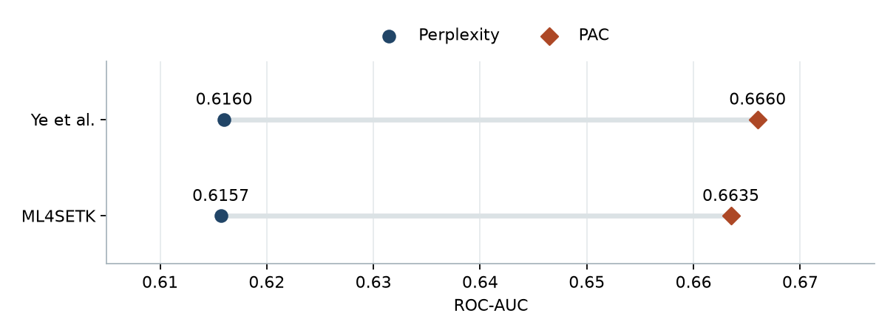
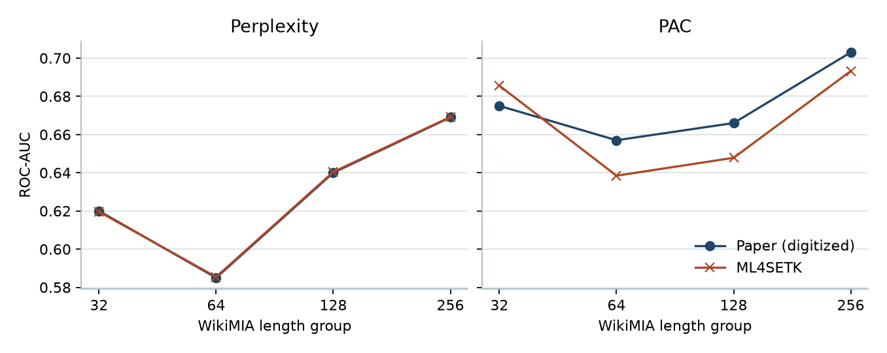

# PAC reproduction report

[Source module `ml4setk.MIA.pac`](https://github.com/jkatzy/ML4SE-toolkit/blob/fdd40a7/src/ml4setk/MIA/pac.py) · [Reproduction script](https://github.com/jkatzy/ML4SE-toolkit/blob/65fdb41/reproductions/ml4setk/MIA/test_pac.py)

*Data Contamination Calibration for Black-box LLMs*. Wentao Ye, Jiaqi Hu, Liyao Li, Haobo Wang, Gang Chen, and Junbo Zhao. Findings of ACL 2024. [Paper](https://doi.org/10.18653/v1/2024.findings-acl.644)

## Model selection and toolkit API

Ye et al. evaluated ten target models across Table 1. The paper specifies a model for each row. The authors’ released program requires the user to select a local checkpoint or a hosted model. GPT-Neo-2.7B is the checkpoint chosen for the ML4SETK reproduction of one row. [Paper, §5.1 and Table 1](https://aclanthology.org/2024.findings-acl.644.pdf) · [Authors’ model selection code](https://github.com/yyy01/PAC/blob/79c6eca14fed3a64a7a4201cdca263de52501dae/src/prob.py#L40-L46)

| Table 1 datasets | Target models |
| --- | --- |
| Both WikiMIA and StackMIAsub | LLaMA-13B, LLaMA2-13B, GPT-J-6B, GPT-Neo-2.7B, OPT-6.7B, Pythia-6.9B |
| WikiMIA only | davinci-002, babbage-002 |
| StackMIAsub only | StableLM-7B, Falcon-7B |

**The installed PAC module currently evaluates precomputed scores.** Its public function, `evaluate_pac_scores(members=..., nonmembers=...)`, returns aggregate metrics. Model loading and text scoring for the GPT-Neo comparison live in the reproduction script. The package still needs text-scoring calls for both the configuration’s default checkpoint and a caller-supplied model and tokenizer.

## Ye et al., Table 1 · GPT-Neo-2.7B on WikiMIA

The paper reports a ROC-AUC increase of **0.050** from perplexity to PAC. ML4SETK measured an increase of **0.047805** on the same original-text WikiMIA benchmark. The comparison pools 861 members and 789 nonmembers across the four length groups in Table 6. [Ye et al., Findings of ACL 2024](https://aclanthology.org/2024.findings-acl.644/)

| Method | Paper ROC-AUC | ML4SETK ROC-AUC |
| --- | ---: | ---: |
| Perplexity | 0.616 | 0.615686950 |
| PAC | 0.666 | 0.663491475 |

The closest published baseline in this row is Min-K% at 0.648. Its ML4SETK measurement is pending, so this run checks the gain over perplexity only. For ROC-AUC, the toolkit follows the authors’ released evaluator, which negates the raw PAC scores. Algorithm 1 in the paper presents a greater-than threshold on the raw score. The comparison above checks ranking under the released evaluator’s convention. [Table 1 and Algorithm 1](https://aclanthology.org/2024.findings-acl.644.pdf) · [Authors’ evaluation code](https://github.com/yyy01/PAC/blob/79c6eca14fed3a64a7a4201cdca263de52501dae/attack.py#L44-L49)



The run used float32 weights, five word-swap variants per text, and the highest 5% and lowest 30% of next-token log probabilities. The script computes scores from model outputs and calls ML4SETK’s PAC and loss evaluators for ROC-AUC. It used seed 42. The authors’ realized draws were unavailable. [Table 1 comparison data (CSV)](data/pac_table1.csv) · [Dataset revision](https://huggingface.co/datasets/swj0419/WikiMIA/tree/a89ab76d88f704e9bc5870ac39cc9d458a2a70ac) · [Model revision](https://huggingface.co/EleutherAI/gpt-neo-2.7B/tree/e24fa291132763e59f4a5422741b424fb5d59056)

## Figure 7 · GPT-Neo on WikiMIA by text length

The fresh run scored all 1,650 original WikiMIA texts on one NVIDIA A40. Each of the four perplexity AUCs agrees with the published curve at three decimals. PAC is higher than the plotted value in the 32 group and lower in the other three groups. The largest gap is in the 64 group, where the run gives 0.6384 and the digitized curve gives about 0.6566. The pooled point in Figure 7 uses all texts and is reported in the Table 1 comparison above.

| Length | Paper perplexity | ML4SETK perplexity | Paper PAC | ML4SETK PAC |
| ---: | ---: | ---: | ---: | ---: |
| 32 | 0.620 | 0.619584 | 0.675 | 0.685578 |
| 64 | 0.585 | 0.585449 | 0.657 | 0.638443 |
| 128 | 0.640 | 0.640417 | 0.666 | 0.647806 |
| 256 | 0.669 | 0.669197 | 0.703 | 0.693232 |



Paper values are approximate. The figure check reads the PPL and Ours line vertices against the GPT-Neo panel’s y-axis tick marks in the proceedings PDF and rounds to three decimals. The new measurements use the same seed and checkpoint as the pooled run. [Paired values (CSV)](data/pac_figure7_gpt_neo.csv) · [Published Figure 7](https://aclanthology.org/2024.findings-acl.644.pdf#page=16)

## Table 1 mean improvements

The authors give a relative gain over the strongest baseline for each dataset and text variant. The last column recalculates that gain as 100 × (PAC / strongest baseline − 1) using the published mean AUCs. For original StackMIAsub, even allowing for rounding each AUC to three decimals gives a range of 4.55% to 4.89%. The reported 5.9% falls outside that range. These calculations check the published summaries independently of model inference. [Table 1, page 10852](https://aclanthology.org/2024.findings-acl.644.pdf#page=8)

| Dataset | Text | Mean PAC | Best baseline (Min-K%) | Paper gain | Calculated gain |
| --- | --- | ---: | ---: | ---: | ---: |
| WikiMIA | Original | 0.657 | 0.629 | 4.5% | 4.45% |
| StackMIAsub | Original | 0.621 | 0.593 | 5.9% | 4.72% |
| WikiMIA | Rewritten | 0.659 | 0.623 | 5.8% | 5.78% |
| StackMIAsub | Rewritten | 0.577 | 0.549 | 5.1% | 5.10% |

## Coverage of the original paper

**Partial reproduction.** The comparison above covers two of the 224 model-specific AUC values in Table 1. Each dataset has eight evaluated models, two text variants and seven methods. The mean rows and improvement percentages are derived summaries. The CPU checks independently reproduce the cohort counts in Tables 5 and 6. All seven empirical figures in the paper still have experiments pending. No hardware exception has been established. [Published figures, tables, and appendices](https://aclanthology.org/2024.findings-acl.644.pdf)

| Published item | Experiment or evidence | Current coverage |
| --- | --- | --- |
| Figure 1 | Diagram of the PAC method | Schematic |
| Figure 2 | Member and nonmember confidence distributions before and after calibration for davinci-002 on WikiMIA | Pending |
| Figure 3 | AUC by training exposure count, number of adjacent samples, sample length, and model size | All four sweeps pending |
| Figure 4 | Whole-sample and output-only detection after five epochs of LLaMA-13B fine-tuning on Platypus | Pending |
| Figure 5 | GPT-3 contamination estimates for selected TOXIGEN examples | Pending |
| Figure 6 | Detection score and sentiment on WikiMIA and StackMIA | Pending. Appendix G gives the plotted axes but no sentiment model or per-example values. |
| Figure 7 | WikiMIA AUC by model, method, and text length | GPT-Neo perplexity and PAC curves measured below. Other methods and model panels remain pending. |
| Figure 8 | StackMIAsub AUC by model, method, and text length | StackMIAsub inference is pending. The published plot repeats all 48 curves from Figure 7, including the same axis labels. |
| Table 1 | Detection AUC across models, methods, datasets, and original or rewritten inputs | Two model-specific cells measured. Four published mean gains checked arithmetically above. |
| Table 2 | Five augmentation settings and five score choices on each dataset | Both ablations pending |
| Table 3 | Threshold selection on subsets from 10% to 50% in five-percentage-point steps | Accuracy and threshold variability pending |
| Table 4 | Four GPT models on GSM8K, AQuA, and TOXIGEN | All four weighted averages checked below. Per-example model measurements pending. |
| Table 5 | StackMIAsub composition by length and membership | All four groups independently counted below |
| Table 6 | WikiMIA composition by length and membership | All four groups independently counted below |
| Table 7 | Examples of original and rewritten texts | All original examples located in the released dataset. Regeneration of the rewrites remains pending. |

### Table 4 aggregate check

Weighting each published dataset rate by its sample count recovers all four reported averages to one decimal place. This verifies the arithmetic. The authors’ per-example hosted-model responses are unavailable in the pinned artifact.

| Model | Paper average | Calculated average |
| --- | ---: | ---: |
| davinci-002 | 89.4% | 89.44% |
| babbage-002 | 77.7% | 77.66% |
| gpt-3.5-turbo | 34.6% | 34.60% |
| GPT-4 | 21.9% | 21.92% |

### Table 5 cohort check

The released StackMIAsub file contains 8,267 records with text and binary labels. Counting whitespace-separated words gives the intervals below. The observed lengths range from 33 to 1,041. The counts are members / nonmembers. [Pinned dataset](https://huggingface.co/datasets/darklight03/StackMIAsub/tree/c87c55d8b93fcf525fbf5fbf9b3bff6808b30ac6)

| Paper length group | Observed grouping rule | Paper | Counted |
| --- | --- | ---: | ---: |
| 32 | 33–64 words | 1,596 / 1,615 | 1,596 / 1,615 |
| 64 | 65–128 words | 1,740 / 1,740 | 1,740 / 1,740 |
| 128 | 129–256 words | 680 / 720 | 680 / 720 |
| 256 | More than 256 words | 90 / 86 | 90 / 86 |
| Total | All | 4,106 / 4,161 | 4,106 / 4,161 |

Table 7 prints five original/rewritten pairs. The last pair appears twice. All four distinct originals match released member records in the 33–64 word group after normalizing case, punctuation, accents, and PDF line breaks. The deposit supplies original texts and labels. It does not include the authors’ generated rewrite for each record.

### Table 6 cohort check

The reproduction script checks the labels in the pinned original-text files before it loads the model. Counts below are in members / nonmembers. [Dataset revision](https://huggingface.co/datasets/swj0419/WikiMIA/tree/a89ab76d88f704e9bc5870ac39cc9d458a2a70ac) · [Run the check](#reproduce-these-measurements)

| Text length | Paper | Counted |
| --- | ---: | ---: |
| 32 | 387 / 389 | 387 / 389 |
| 64 | 284 / 258 | 284 / 258 |
| 128 | 139 / 111 | 139 / 111 |
| 256 | 51 / 31 | 51 / 31 |
| Total | 861 / 789 | 861 / 789 |

### Figures 7 and 8 in the published PDF

The captions identify Figure 7 as WikiMIA and Figure 8 as StackMIAsub. In the proceedings PDF, all 240 vertices coincide after translating one figure horizontally (eight panels × six curves × five x positions). Their model labels, tick labels, and legends also coincide. Table 1 gives different pooled results for the two datasets. For GPT-Neo it gives PAC AUCs of 0.666 and 0.600, while both figures plot approximately 0.666. Figure 8 therefore provides no separate graphical reference for the StackMIAsub curves. [Proceedings page 10860](https://aclanthology.org/2024.findings-acl.644.pdf#page=16)

## Reproduce these measurements

Run from the repository root with a CUDA GPU. The script downloads the pinned datasets and GPT-Neo checkpoint on first use. To run just the two dataset checks on CPU, append `-k "table5 or table6"` to the pytest command.

```bash
uv venv --python 3.13 /tmp/ml4setk-repro
uv pip install --python /tmp/ml4setk-repro/bin/python -e . pytest==9.0.2 \
  torch==2.8.0 transformers==4.55.4 pandas==3.0.6 pyarrow==25.0.0 numpy==2.5.5
/tmp/ml4setk-repro/bin/python -m pytest -o addopts= -qs reproductions/ml4setk/MIA/test_pac.py
```

For the arithmetic and example provenance checks, use the original paper and the same pinned StackMIAsub file. The table checker uses Python 3 and Poppler’s `pdftotext`. The figure checker reads the vector paths in the same PDF using PyMuPDF. [Table check script](https://github.com/jkatzy/ML4SE-toolkit/blob/65fdb41/reproductions/ml4setk/MIA/check_pac_tables.py) · [Figure check script](https://github.com/jkatzy/ML4SE-toolkit/blob/65fdb41/reproductions/ml4setk/MIA/check_pac_figures.py)

```bash
curl -fL https://aclanthology.org/2024.findings-acl.644.pdf -o /tmp/pac-acl.pdf
curl -fL https://huggingface.co/datasets/darklight03/StackMIAsub/resolve/c87c55d8b93fcf525fbf5fbf9b3bff6808b30ac6/StackMIAsub.jsonl -o /tmp/pac-stackmia.jsonl
python reproductions/ml4setk/MIA/check_pac_tables.py /tmp/pac-acl.pdf /tmp/pac-stackmia.jsonl
uv run --with PyMuPDF==2.1 python reproductions/ml4setk/MIA/check_pac_figures.py /tmp/pac-acl.pdf
```
