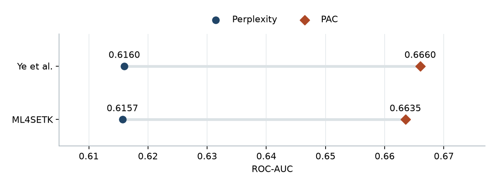

# PAC reproduction report

*Data Contamination Calibration for Black-box LLMs*. Wentao Ye, Jiaqi Hu, Liyao Li, Haobo Wang, Gang Chen, and Junbo Zhao. Findings of ACL 2024. [Paper](https://doi.org/10.18653/v1/2024.findings-acl.644)

## Ye et al., Table 1 · GPT-Neo-2.7B on WikiMIA

The paper reports a ROC-AUC increase of **0.050** from perplexity to PAC. ML4SETK measured an increase of **0.047805** on the same original-text WikiMIA benchmark. The comparison pools 861 members and 789 nonmembers across the four length groups in Table 6. [Ye et al., Findings of ACL 2024](https://aclanthology.org/2024.findings-acl.644/)

| Method | Paper ROC-AUC | ML4SETK ROC-AUC |
| --- | ---: | ---: |
| Perplexity | 0.616 | 0.615686950 |
| PAC | 0.666 | 0.663491475 |



The run used float32 weights, five word-swap variants per text, and the highest 5% and lowest 30% of next-token log probabilities. The script computes scores from model outputs and calls ML4SETK’s PAC and loss evaluators for ROC-AUC. It used seed 42. The authors’ realized draws were unavailable. [Table 1 comparison data (CSV)](data/pac_table1.csv) · [Dataset revision](https://huggingface.co/datasets/swj0419/WikiMIA/tree/a89ab76d88f704e9bc5870ac39cc9d458a2a70ac) · [Model revision](https://huggingface.co/EleutherAI/gpt-neo-2.7B/tree/e24fa291132763e59f4a5422741b424fb5d59056)

This run covers the PAC and perplexity entries in the GPT-Neo original-text row. The other Table 1 models, synonymous rewrites and StackMIAsub experiments remain untested here.

## Reproduce these measurements

Run from the repository root with a CUDA GPU. The script downloads the pinned WikiMIA texts and GPT-Neo checkpoint on first use. [Reproduction script](https://github.com/jkatzy/ML4SE-toolkit/blob/2e976ea/reproductions/test_pac.py)

```bash
uv venv --python 3.13 /tmp/ml4setk-repro
uv pip install --python /tmp/ml4setk-repro/bin/python -e . pytest==9.0.2 \
  torch==2.8.0 transformers==4.55.4 pandas==3.0.6 pyarrow==25.0.0 numpy==2.5.5
/tmp/ml4setk-repro/bin/python -m pytest -o addopts= -qs reproductions/test_pac.py
```
